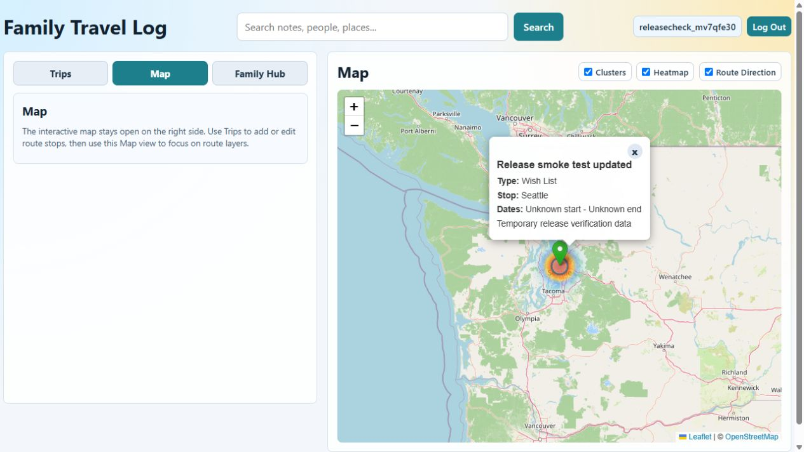

# Release milestone status — updated October 19, 2026

The Modern Planner website and backend are live and verified on the existing public
domain. The matching iPhone build, physical-device review, and operations handoff
remain open. Historical release notes below describe earlier builds.

## Modern Planner — live on the existing domain, October 19

Website: https://family-travel-log-app-codex.vercel.app. The backend runs feature
release `e711b37baf95bc9e080565f12d439dccb856fca0`; the current web layout runs
`6e6711f7cae1e636596bc4cca48029c548c28843`. The existing Render service, Neon
production database, Vercel project, and public domain were reused.

- Render deployment `dep-dbbe0ke7bikc7387hl9g` is live on the existing API origin.
  The additive startup migration installed trip-version protection.
- Initial Vercel deployment `dpl_GkCKHejX5tLeTAM7uyK7WUXYSPAq` was promoted to the existing
  primary domain after its source-commit metadata was verified.
- Fresh pre-rollout Neon recovery checkpoint: `pre-modern-planner-rollout-2026-10-19`
  (`br-frosty-cherry-anf7zqsa`), copied from production without a compute endpoint.
- Full cloud release confidence passed on that exact code commit:
  https://github.com/tingyuho/family-travel-log-app-codex/actions/runs/39361433602.
  Earlier PostgreSQL contract validation used isolated branch `br-damp-unit-anj7lv77`.
- Final production verification passes for release `e711b37baf95`: PostgreSQL, release
  identity, security headers, web entry point, and exact primary-domain CORS preflight.
- Hosted synthetic-account API checks pass for login, trip creation/editing, real
  Yosemite place search, appending a stop, and persistence. Stale edits return 409;
  versionless edits from older clients return 428, as designed.
- Browser checks on the primary domain also passed: login, name-only trip creation,
  editing notes/title, searching and adding Yosemite Valley, reopening after refresh,
  map navigation, and logout. No browser console errors were captured.
  [Live browser evidence](docs/images/modern-planner-live.jpg).
- Synthetic test data is isolated to account `moderncheck_mvg35xjs`. No password,
  session token, or database connection string is stored in this repository.

The old unique staging address is superseded by the primary domain. Its original
Failed to fetch error came from the staging origin being outside the production
CORS allowlist. The primary domain passes its CORS check. The earlier
[staging screenshot](docs/images/modern-planner-staged.jpg) is historical evidence only.

Chrome's red Dangerous badge from the owner's screenshot remains a separate owner
check: the public Google report returned No available data for the old staging
address. That result does not establish that the warning was incorrect or cleared.
If the primary domain also warns, stop before entering credentials and inspect
Chrome's reason and Search Console Security Issues; request Google's review after
any reported issues are resolved. Do not bypass the warning or turn protection off.

The Expo account-access command was declined at the execution permission prompt.
No new signed Modern Planner iOS build or App Store Connect submission was started.
The previous 1.0.0 build 3 remains the latest known signed build. Older iPhone clients
can read/create trips but cannot edit trips or use their old Quick Stop save operation
against this backend. Use the website for editing until the matching update is installed.

Owner actions: approve Expo account/build access so the matching candidate can be
built and submitted, install it through TestFlight once Apple finishes processing,
and perform the physical-device checklist. Tester invitations and public App Store
review have not been sent. See `docs/MODERN_PLANNER_HANDOFF.md`.

## Web layout refinement — October 19

Vercel deployment `dpl_3wVCTTiihc1ygc2ckEj3gsYPcLA4` now serves the existing
primary domain from web source `6e6711f7cae1e636596bc4cca48029c548c28843`.
The backend and database configuration did not need another deployment.

- Corrected the panel background cascade so the trip area no longer forms a white
  slab with uneven edges. Each card has its own consistent rounded boundary.
- Replaced the full dashboard itinerary with a compact spotlight and Open plan
  action. Full Itinerary, Places, Stays, notes, and travelers remain in trip details.
- Grouped search/view controls, tightened card metadata and spacing, and collapsed
  mobile filters behind an accessible Filters button with an active-filter count.
- Selection outlines now appear only in Select mode; returning from a focused map
  no longer leaves a card looking selected.
- Validation: 31 web tests, the production build, repository secret scan, and final
  production verification passed. Browser checks covered details sections, phone
  filter open/apply/close behavior, empty results, map return, and selection styling.
  Layouts at 320 px and 390 px have no horizontal overflow. Hosted login and full
  itinerary access pass; no browser console errors were captured.
- With the same hosted synthetic trips, the full page now measures 799 px high
  at a 1280 × 720 viewport, and the library begins at 323 px.

[Updated live layout](docs/images/modern-planner-compact-live.jpg). The earlier
`modern-planner-live.jpg` is retained as pre-refinement evidence.

## Modern Planner design — locally verified October 19

- Web uses a sidebar workspace, blue accents, compact trip summaries, and responsive
  bottom navigation on phones. Saved trip plans have Itinerary, Places, and Stays
  sections, with travel companions and notes beside the plan on larger screens.
- Maps have a dedicated full-width view and remain available alongside trip editing.
  Map layers mount only while visible, avoiding a zero-width heatmap rendering failure.
- Mobile uses the same palette and control styling, trip totals, and trip-section
  navigation. Sign-in, family, packing, forms, and map controls share the updated style.
- Destination artwork is bundled locally as decorative planner artwork. No trip-photo
  upload or storage feature is implied. The selected Family Journal draft was replaced.
- The web Add Stop form now calls the dedicated stop endpoint consistently.

Browser verification used a disposable SQLite database: sign-in, reading real saved
itineraries/places/stays, creating and editing trips, opening the map and returning to
details, and saving a stop with its dated note all passed. Layouts at 320 px and 390 px
fit without horizontal scrolling. The local geocoder has no provider credentials;
stop selection was verified with a cached place fixture, including persisted API data.
[Desktop design evidence](docs/images/modern-planner-desktop.jpg).

Verification: 31 web tests and 40 mobile tests pass, including trip-section navigation.
The web production build, mobile TypeScript, and production-configured local iOS export
pass. Physical iPhone
visual acceptance and deployment remain outstanding; these are local source changes.

## Reliability improvements — locally verified October 19

- Mobile packing checks survive startup and delayed template loading; account changes
  cannot copy checks or unfinished trip drafts into another account.
- Trip and stop saves use the saved response directly. A failed unrelated refresh
  cannot turn a completed save into a failed result or keep the saved stop form open.
- Full trip edits use a database version check. Stale edits are rejected with the
  draft retained and a Review latest action; older unversioned edits are rejected
  safely. Stop additions use their own operation and preserve concurrent changes.
- Web drafts are saved per account, recover after refresh, and require Restore or
  Discard. Restored edits retain the original version and saved family-member names.
- Web map layers, trip-plan fields, itinerary display, and account UI are extracted
  into components. Mobile save actions and date controls are extracted as well.

Verification: 31 web tests, 39 mobile tests, 21 SQLite/backend tests, mobile TypeScript,
web production build, API contract snapshot, repository secret scan, local production
configuration iOS export, iOS preflight, isolated backend smoke check, and artifact URL
scan pass. The opt-in PostgreSQL contract test was extended but skipped locally because
no disposable PostgreSQL test server is configured.

Browser checks against a temporary SQLite database passed immediate-reload draft
recovery, restoration and saving, clearing after save, stale-edit rejection, retained
edit versions after reload, reviewing the newer trip, and saving a fresh edit. Two
simultaneous HTTP stop additions both persisted without reverting the title or people.
Unauthenticated reads return 401 and legacy full edits return 428. The account screen
renders after extraction. [Conflict evidence](docs/images/trip-conflict-verification.jpg).

These changes are local. Production PostgreSQL migration, deployment, a new signed
iOS build, and real iPhone acceptance have not been performed. Follow the trip editing
compatibility section in DEPLOYMENT.md: backend first, then matching web/iOS clients.

## Local UI improvements — not released

Priorities 1 and 2 of the shared mobile/web usability plan are implemented locally.
Family Hub's account, profiles, and packing organization remains in place (priority 3 deferred).

- Mobile has labeled bottom navigation; web has labeled main navigation. Logout is in the existing account area.
- Trip cards open details; explicit Select controls enable map comparison.
- Wishlist changes retain entered dates, including in API save payloads. Dates remain optional.
- Trips, drafts, filters, and navigation context are retained across tab changes; returning from a web trip map restores the list position.
- Trips has direct search, List/Timeline choices, Add Trip, and Add Stop. The web creation form is opened explicitly, with optional details collapsed.
- Add Stop from the library asks for a trip; from details it uses that trip. Searchable trip selection, save confirmations, pending-save protection, and discard prompts are provided.
- Web editing preserves saved people without a matching Family Profile unless explicitly unchecked.
- The earlier mobile map overlap fix remains included. Empty maps show guidance without an overlapping details card.

Local verification: 28 mobile unit/interaction tests, 26 web tests, mobile TypeScript,
web production bundle, and local iOS bundle export passed. Browser checks used a
temporary local SQLite database and sample trips: name-only creation, draft retention,
Add Stop persistence after reload, dated Wishlist save, saved people retention, explicit
selection, map return path, and a 390px responsive layout. The map return check restored
the same list scroll position. Location-search results were fixtures; the saved trip
updates used the real local API and database.

These changes have not been deployed or included in a new TestFlight build. No EAS
build or submission was started. Real iPhone acceptance remains pending.

## Completed

- Saved and pushed the release baseline on `codex/production-readiness-phase-0-1`.
- Opened draft PR #8: https://github.com/tingyuho/family-travel-log-app-codex/pull/8.
- Fixed Windows test-folder permissions and Node 20 web-test discovery.
- Added a disposable PostgreSQL CI service; its contract check passes.
- Full cloud release confidence passes for code commit `51d3911045e9`, including
  the production web build, 22 web tests, mobile type checks, 20 mobile tests,
  contract/scaffold checks, iOS export, backend checks, and 17 backend tests.
- Validated startup and CRUD contracts against an isolated copy of the existing
  Neon database, without running contract tests against production.
- Created the no-compute recovery branch `pre-release-2026-10-13`
  (`br-silent-unit-anehy364`) in Neon project `solitary-bar-65423790`.
- Retained the isolated validation branch `release-contract-2026-10-13`
  (`br-raspy-king-anpeouzz`). It is a test copy, not the production database.
- Configured Render production mode, exact browser origins, PostgreSQL health
  checks, and Nominatim location search with an identifying user agent.
- Deployed the backend release candidate to
  https://family-travel-log-app-codex.onrender.com.
- Verified structured request logs on Render for backend release `51d3911045e9`.
- Removed Vercel's obsolete `frontend` root override and rebuilt the same code
  commit for production. The live site is https://family-travel-log-app-codex.vercel.app.
- Full production verification now passes, including browser security headers,
  PostgreSQL, API contract, release identity, request IDs, and browser CORS.
- Browser smoke checks passed for registration, logout/login, trip creation,
  editing, persistence after refresh, and map marker/detail selection. Synthetic
  data is isolated in account `releasecheck_mv7qfe30`; its test trip is retained.
  No test password is stored in the repository.
- Verified PostgreSQL health, release identity, request IDs, security headers,
  allowed browser CORS, rejection of an untrusted origin, and unauthenticated
  trip-access rejection.
- Set GitHub production URL variables for the verification workflow.
- Set the EAS production API origin and included the existing sensitive Maps key
  in production. Its Google platform restrictions still need owner verification.
- Added an iPhone login/navigation/logout Maestro flow and encryption metadata.
- Confirmed matching active App Store signing credentials for
  `com.tyhotw.familytravellogmobile` and configured App Store Connect app ID
  `6778994659`.
- Production iOS version `1.0.0`, build `2`, finished successfully on October 14.
  EAS build: https://expo.dev/accounts/tyhotw/projects/family-travel-log-mobile/builds/6e8f48a8-39f6-462a-93bd-20975baf5355.
- Uploaded that exact build to App Store Connect successfully on October 14 using
  the configured EAS submission credentials. Submission:
  https://expo.dev/accounts/tyhotw/projects/family-travel-log-mobile/submissions/0e52bd32-ff6f-4efe-8735-82ff77315cd3.
  Apple processing was still pending when the submission completed.

## Quick Stop picker update — build 3

The Quick Stop form now displays one selected trip with its dates and a Change
button. Change opens a native picker with five recent trips, search across all trips
by name/date, and a scrollable Show all list. The selected row is marked. Changing
trips preserves the place, stop label, and note. The destination is repeated above
Save Stop. Trip Details includes Quick Stop with the current trip preselected.

Version `1.0.0` build `3` was built and uploaded to Apple on October 15. Apple
processing was pending at submission completion. Build:
https://expo.dev/accounts/tyhotw/projects/family-travel-log-mobile/builds/3aab9b11-f33e-47cf-ab47-1411e699ee84.
Submission:
https://expo.dev/accounts/tyhotw/projects/family-travel-log-mobile/submissions/d39bd211-2394-4ad1-a465-86c4d33b4679.

Validation includes a 500-trip dataset, picker search/selection/dismissal interaction,
mobile TypeScript, API integration tests, production iOS export, and a successful
signed native iOS build. Real iPhone acceptance remains to be run on build 3.

## Remaining gates

1. **Matching Modern Planner iPhone build.** Expo account access was declined, so
   build and submission are still pending. Approve the access/build prompts or
   follow `docs/MODERN_PLANNER_HANDOFF.md`. After a new successful build is submitted,
   wait for Apple processing and select it for the intended internal TestFlight group.
   The earlier build 3 does not contain Modern Planner.
   Tester invitations and public App Store review have not been dispatched.
2. **Real iPhone acceptance.** Run the authenticated Maestro flow plus the full
   manual checklist in `apps/mobile/ROLL_OUT_CHECKLIST.md`. No real-device pass
   has been claimed. Complete the remaining hosted web checks for people, packing,
   calendar export, password reset, and trip deletion.
3. **Operations handoff.** The hourly workflow is prepared and its URL variables
   are set, but it needs the workflow on the default branch. Confirm alert owners,
   daily backup retention, an off-provider
   archive, and a restore drill. The Neon project currently reports a six-hour
   history window; the recovery branch is a pre-release checkpoint, not a daily
   backup policy.

## Deployment ownership and rollback

Render now tracks the release branch with automatic deployments disabled. This
prevents the legacy branch from replacing the manually verified candidate. After
PR #8 is merged, point Render at `master` and enable deployment after checks pass.
Do not enable automatic deployments from the obsolete accommodation branch.

If rolling back to a commit before `backend/logging.json` was introduced, also
restore the old start command without `--log-config logging.json`. Keep the database
recovery branch until the release and recovery checks are complete. Retire the test
branch through the owner's normal database cleanup process when no longer needed.

See `DEPLOYMENT.md`, `OPERATIONS.md`, and `RELEASE_CHECKLIST.md` for procedures.

