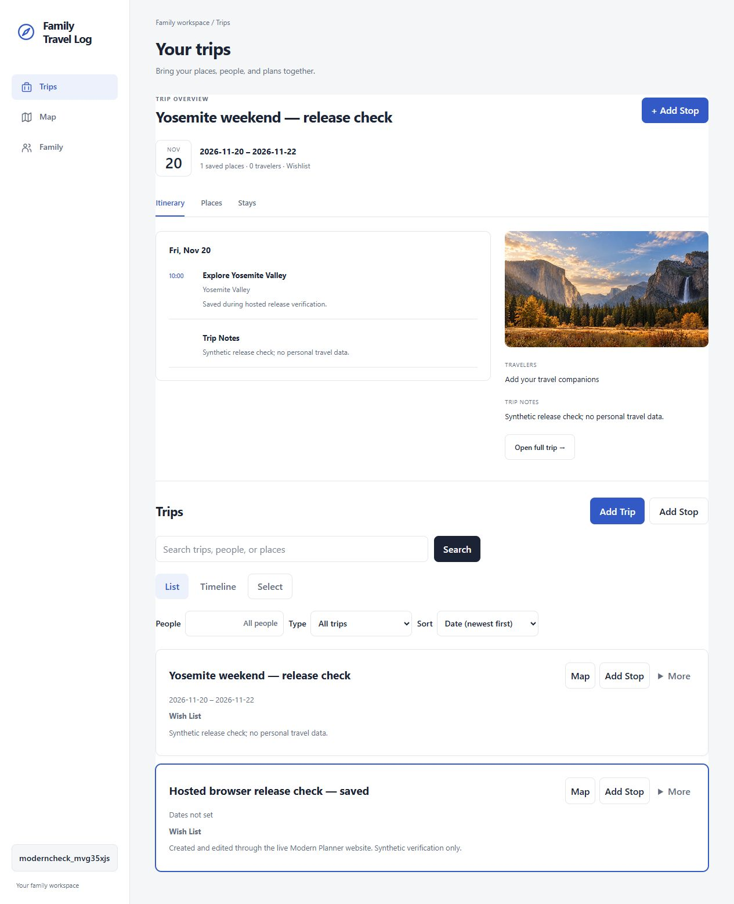

# Modern Planner owner handoff — October 19, 2026

## Website

Open https://family-travel-log-app-codex.vercel.app. This existing domain now serves
Modern Planner and uses the matching production backend. Do not use the older
unique preview address as the release URL.

The tested code commit is `e711b37baf95bc9e080565f12d439dccb856fca0`. Render deployment
`dep-dbbe0ke7bikc7387hl9g` and Vercel deployment `dpl_GkCKHejX5tLeTAM7uyK7WUXYSPAq`
serve the matching release. PostgreSQL health, primary-domain CORS, auth, trip saves,
real place search, appended stops, and edit-conflict protection were verified.
Browser checks also passed for creating/editing a trip, adding a searched place,
refresh persistence, map navigation, and logout.



## Owner actions

1. Open the existing website in your usual Chrome profile. If the red Dangerous
   warning remains on this exact domain, do not enter credentials. Read the reason
   shown by Chrome and check the owner's Search Console Security Issues report.
   The old preview's public Google report returned No available data; this does
   not clear its warning. Resolve reported issues and request review as needed.
2. Approve Expo account access and the signed build permission when requested,
   or run the production iOS build yourself from this checkout. Account access
   was declined during this release, so no new native build or upload was started.
3. Submit only the new successful Modern Planner build to App Store Connect.
   Wait for Apple processing and select that build for the intended internal
   TestFlight group. Do not mistake the earlier 1.0.0 build 3 for this update.
4. Install the new TestFlight build on a physical iPhone. Check login, trip create
   and edit, place search and Add Stop, map navigation, packing after relaunch,
   and logout/login. Record the build number and result in the mobile checklist.

Until the matching iPhone update is installed, use the website for trip editing.
Older iPhone clients can read/create trips, but full edits and their old Quick Stop
save operation now receive HTTP 428. No physical-device pass is claimed.

## Optional owner-run iPhone commands

From the repository root, run `npm run mobile:build:ios:production`. Complete any
Expo or Apple sign-in prompts directly; do not send credentials in chat. Confirm
the result is a successful new build for project `ecb04a1d-d864-4c6a-bb80-3ba4e3aea87b`,
bundle `com.tyhotw.familytravellogmobile`, with a build number greater than 3.

Submit that exact new build from `apps/mobile`:

```powershell
npx eas-cli submit --platform ios --profile production --id NEW_SUCCESSFUL_BUILD_ID
```

Replace the placeholder with the ID returned by the successful build. Do not submit
the previous latest build if a new build failed or never started. App Store Connect:
https://appstoreconnect.apple.com/apps/6778994659/testflight/ios. Tester invitations
and public App Store review have not been dispatched.

## Source and operations follow-up

PR #8 remains the source-review entry point:
https://github.com/tingyuho/family-travel-log-app-codex/pull/8. The default branch
still needs the reviewed changes before normal default-branch deployments resume.
Render follows the release branch with automatic deploys off. Do not replace this
backend with the older versionless write handler while updated clients are in use.

The fresh recovery checkpoint is `br-frosty-cherry-anf7zqsa`; it has no compute
endpoint and does not replace an ongoing backup policy. Follow OPERATIONS.md for
backup retention, restore drills, monitoring, and ownership.
